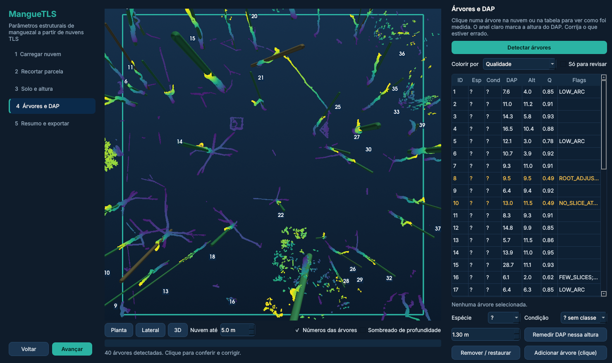

# MangueTLS

Extração semiautomática de DAP, altura, densidade e área basal de florestas de mangue a partir de nuvens de pontos de laser scanner terrestre (TLS), com uma janela de revisão passo a passo para o usuário conferir e corrigir cada árvore.

> **Status: protótipo em desenvolvimento (v0.2.0).** O código roda e foi testado em cinco parcelas de Guaratiba (RJ), mas ainda não está calibrado nem validado o bastante para substituir a medição manual. Veja "Estado da validação".

Desenvolvido no contexto de um doutorado em Oceanografia Biológica (PPGOCN/UERJ), vinculado ao Núcleo de Estudos em Manguezais (NEMA/UERJ).

## Por que existe

Os algoritmos de TLS para florestas terrestres assumem tronco único, solo visível e medição do DAP a 1,30 m. Em manguezal isso falha por causa de:

- raízes-escora de *Rhizophora mangle*, que passam de 1,30 m e geram falsos troncos;
- troncos inclinados, tortuosos, bifurcados ou com vários fustes;
- solo alagado, que cria lacunas no modelo digital do terreno;
- oclusão pelo sub-bosque de raízes e troncos finos;
- ruído de vento nos troncos e nas copas.

Hoje o fluxo manual (registro no FARO SCENE e extração de DAP e altura no ReCap Pro) é lento e subjetivo. O MangueTLS tenta automatizar a parte repetitiva e deixar a decisão final com a pessoa.

## O que faz

**Motor (`tls_mangue`)**

1. Leitura de `.e57`, `.las`, `.laz`, `.pts`, `.xyz` e `.csv`, com redução por voxel e remoção de ruído (SOR e ROR).
2. Modelo digital do terreno por percentil baixo em grade, robusto a lacunas de água, com filtro regional para células sem retorno do chão.
3. Detecção de fustes em várias fatias de altura (círculos por RANSAC encadeados), com filtro de raízes-escora por extrapolação do eixo.
4. DAP adaptativo, medido acima da raiz mais alta quando ela passa de 1,30 m.
5. Tabela por fuste (posição, DAP, altura, área basal, flag de qualidade) e resumo da parcela (DAP médio, altura média, densidade e área basal por hectare).
6. Saída com `tree_id` em LAZ para conferência no CloudCompare ou Segfix, e relatório em PDF gerado a cada execução.
7. Módulo de validação (MAPE, RMSE, RMSE%, r, R² e gráficos 1:1) contra planilha de campo.

**Janela de revisão (`mangue_viewer`)**

Carregar nuvem, recortar a parcela, calcular solo e altura, detectar árvores e DAP, e revisar. É possível remover ou restaurar árvore, marcar espécie e condição (viva ou morta), remedir o DAP numa altura escolhida e adicionar árvore clicando na base do tronco. Todas as correções ficam em `correcoes.json`, que no futuro servirão de rótulos para treinar um classificador.



## Instalação

Precisa de Python 3.10, 3.11 ou 3.12. Windows, macOS e Linux.

```bash
git clone https://github.com/luq317/MangueTLS.git
cd MangueTLS
python3 -m venv .venv
source .venv/bin/activate        # Windows: .venv\Scripts\activate
pip install -r requirements.txt
```

No macOS também é possível dar duplo clique em `scripts/abrir_mac.command`, que cria o ambiente na primeira vez e abre a janela.

## Uso

Janela de revisão:

```bash
python iniciar.py                     # abre vazia
python iniciar.py caminho/nuvem.e57   # abre já com uma nuvem
```

Pipeline em linha de comando:

```bash
python -m tls_mangue.pipeline --input parcela.laz --out saidas/P1 --plot-id P1 --plot-area 225
```

Saídas: `stems.csv`, `plot_summary.csv`, `review_list.csv`, `stems_labeled.laz`, `plan_view.png`, `run.json` e `relatorio_<parcela>.pdf`.

Validação contra o campo:

```bash
python -m tls_mangue.validation --field campo.csv --tls saidas/P1/plot_summary.csv --names MANGUETLS --out validacao
```

Use `examples/campo_modelo.csv` como modelo da planilha de campo. Os parâmetros de exemplo estão em `params_exemplo.json` e os parâmetros críticos a calibrar em `tls_mangue/config.py`: tamanho do voxel, faixa de busca de fustes, raio mínimo e máximo, tolerância do RANSAC, arco mínimo e parâmetros do solo.

Testes do código (nuvem sintética e fórmulas das métricas):

```bash
python tests/check_synthetic.py 1
python tests/check_validation.py
```

## Estado da validação

- Os testes automáticos verificam o código, não a ciência.
- Em cinco parcelas de Guaratiba (F2 2023, F2 2024, H2, I2 e F3), o pipeline detecta a maior parte das árvores anotadas manualmente no ReCap, mas também gera falsos positivos grossos que inflam densidade e área basal. A revisão pelo usuário faz parte do fluxo.
- A comparação com o campo é feita no nível da parcela, porque não há DAP de campo pareado por árvore.
- Um classificador de candidatos a tronco foi testado e não melhorou os resultados com os dados atuais.
- Os parâmetros foram ajustados em manguezal baixo de franja. Em outras florestas, calibre antes de usar.

## Limitações conhecidas

- Espécie e condição (viva ou morta) ainda são marcadas à mão. Cor e intensidade do E57 ainda não são usadas.
- Árvores com mais de um tronco: cada tronco é tratado como árvore separada, e o DAP médio da parcela usa o fuste de área basal média.
- Não há desfazer nem salvar sessão; o que fica salvo é o que for exportado.
- Nuvens E57 de 1 GB ou mais levam alguns minutos para ler e precisam de bastante memória.

## Dados

Nuvens, planilhas e resultados de campo **não estão** neste repositório. Os dados de Guaratiba pertencem ao NEMA/UERJ.

## Próximos passos

Usar cor e intensidade para espécie e vivo ou morta, rotular candidatos a tronco para treinar um classificador, leitura de E57 grandes em blocos e empacotar o app para instalar sem terminal.

## Licença

GPL-3.0-or-later. Veja [LICENSE](LICENSE).

## Como citar

Veja [CITATION.cff](CITATION.cff).

---

**English summary.** MangueTLS extracts DBH, height, stem density and basal area of mangrove stands from terrestrial laser scanning point clouds, handling prop roots, leaning and multi-stem trees, flooded ground and occlusion, and provides a step-by-step desktop window to review and correct each tree. It is an early prototype tested on five plots in Guaratiba (Rio de Janeiro, Brazil). Install with `pip install -r requirements.txt` and run `python iniciar.py`. GPL-3.0-or-later.
